<div align="center">


# Estela

**The logbook of a scout group.** A complete management web app for scout units, built on Google Apps Script and Google Drive.

`Google Apps Script` · `JavaScript` · `HTML / CSS` · `Google Sheets` · `Google Drive` · `Canvas` · `Responsive`

</div>

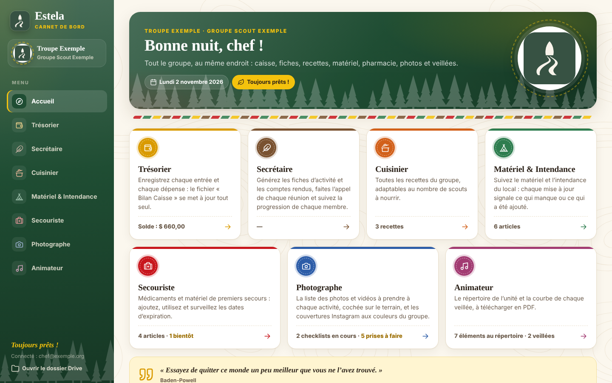

Estela replaces the notebooks, scattered spreadsheets and WhatsApp messages a scout group lives on with **one app per unit** (Meute, Troupe, Clan) plus **one app for the group leadership** (Maîtrise de Groupe). Each section of a unit (treasurer, secretary, cook, quartermaster, first-aider, photographer, campfire leader) gets its own tools, and every piece of data is saved as normal Google Sheets, Docs and PDFs in the group's own Drive. Hosting is free and the data belongs to the group.

The interface is in **French** (the group's working language) and works on phones and computers alike.

> This repository is a **generic, anonymised copy** of the app used by a scout group in Lebanon. Unit names, the group logo, the accounts and the real campsite contacts have been replaced with examples. All screenshots show invented demo data.

---

## Contents

- [Why Estela](#why-estela)
- [Tour of the app](#tour-of-the-app)
  - [Home](#home)
  - [Trésorier: treasury](#trésorier-treasury)
  - [Secrétaire: activity sheets, attendance, progression](#secrétaire-activity-sheets-attendance-progression)
  - [Liste d'emplacements: shared campsite database](#liste-demplacements-shared-campsite-database)
  - [Cuisinier: recipes](#cuisinier-recipes)
  - [Matériel & Intendance: equipment](#matériel--intendance-equipment)
  - [Secouriste: first aid](#secouriste-first-aid)
  - [Photographe: shot lists and Instagram covers](#photographe-shot-lists-and-instagram-covers)
  - [Animateur: repertoire and campfire evenings](#animateur-repertoire-and-campfire-evenings)
  - [Seasons and feast days](#seasons-and-feast-days)
  - [On a phone](#on-a-phone)
  - [Maîtrise de Groupe: the leadership app](#maîtrise-de-groupe-the-leadership-app)
- [How it works](#how-it-works)
- [Repository layout](#repository-layout)
- [Install your own copy](#install-your-own-copy)
- [Customise it](#customise-it)
- [Privacy and security](#privacy-and-security)
- [Credits](#credits)

---

## Why Estela

A scout group's work is spread across many volunteers: one keeps the cash, one takes attendance, one plans the menus, one knows where the tents are. When responsibilities rotate every year, knowledge gets lost. Estela gives every role a clear place to work and keeps everything in the group's Drive, so the next team finds it all.

**Design goals**

- **Zero cost, zero server.** It runs on Google Apps Script with the group's free Google account.
- **The data stays readable.** Every list is an ordinary Google Sheet that you can open, sort or print without the app.
- **Phone-first.** Leaders use it in the field, at camp, with one hand.
- **Safe to hand over.** Folders and files are found by name and created automatically. Nothing breaks if a leader changes.

---

## Tour of the app

### Home

The home page greets the leader according to the time of day. It summarises each section (cash balance, recipes, equipment, medicine expiring soon, photo checklists in progress, campfire repertoire) and shows a scouting quote of the day. Each card opens its section.


### Trésorier: treasury

- **Cash book:** every income and expense with its date, cause, category, type of day (meeting, camp, outing, other) and an optional **event** (e.g. *Christmas camp*). The event groups operations and shows their own balance.
- **Dashboard:** balance, totals, monthly result, breakdowns by type of day and by category ("where does the money go?"). Dollars and Lebanese pounds are kept separately.
- **Yearly fees** (*Cotisation annuelle*): the amount per member, exceptions, full or partial payments. Each payment is written into the cash book.
- **Scout-shop orders** (*Commandes Coop*): who orders what, how much each patrol owes, who has paid, and a PDF order form.

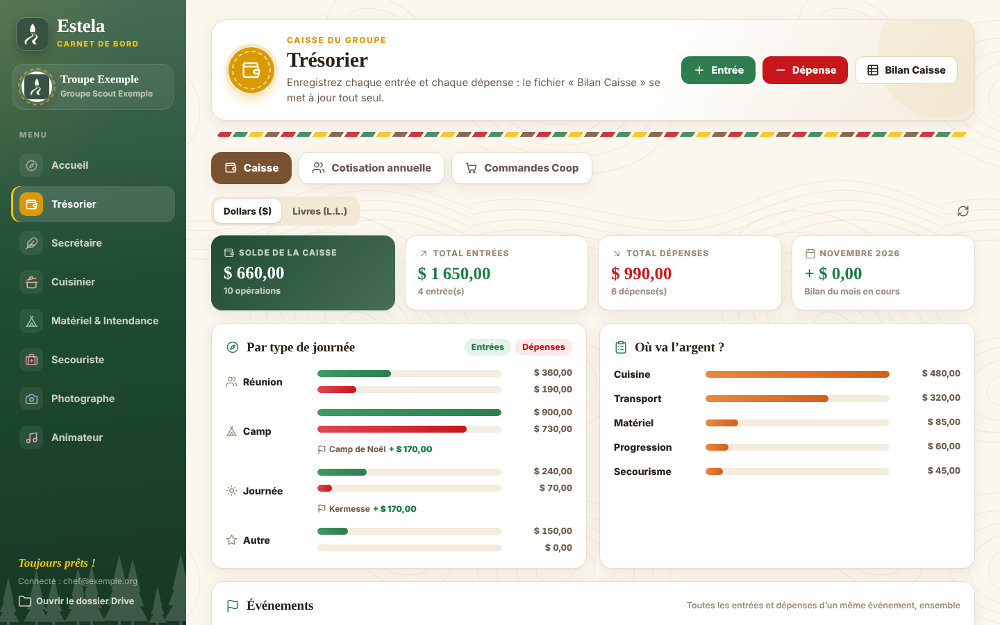

### Secrétaire: activity sheets, attendance, progression

**Activity sheets and reports.** A form produces a formatted **Google Doc** (and optionally a PDF) from the group's own template: goals, detailed explanation, rotation between workshops, equipment and up to 12 photos. Meeting reports and agendas work the same way.

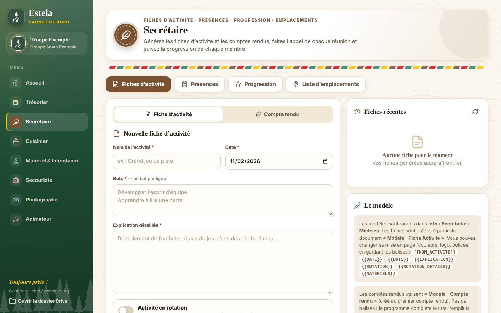

**Attendance.** Members are listed per term, with their patrol and role. Taking the register takes a few taps. Statistics show the attendance rate per member, patrol and term, and meetings meant only for patrol leaders count only the people expected at them.

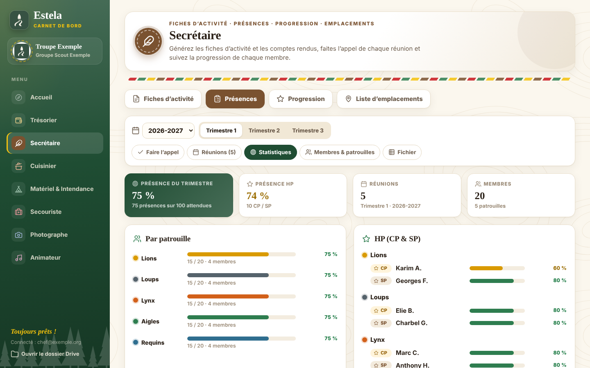

**Progression.** Each member's journey through the stages of the scout method: promise, classes and badges. Every step is a numbered box that can be ticked and dated.

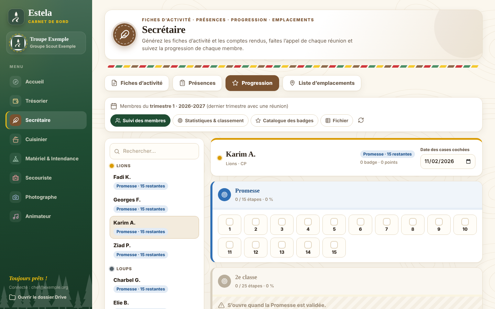

### Liste d'emplacements: shared campsite database

Finding a place to camp is one of the hardest jobs in a scout year. This section is **one database shared by every unit of the group**: when the Troupe adds or edits a campsite, the Meute and the Clan see it straight away.

- Built from two old lists (two PDF exports, about 1,100 rows). These were **extracted, repaired, normalised and deduplicated** into about 970 campsites.
- **Search** across names, villages, contacts and phone numbers.
- **Filters:**
  - **region and district**, grouped like Lebanon's mohafazat and cazas: *Mont-Liban › Metn, Keserwan, Jbeil…*;
  - **type** of place (church, convent, school, forest, scout hall…);
  - **group size**: only places whose capacity is known and large enough;
  - **camp history**.
- **Price** per person, per night or per day, in $ or LL.
- **★ Camp history:** which unit camped there, for which camp, and when. Each card takes **the colour of the last unit that camped there**.
- **Phone numbers checked:** only valid Lebanese numbers (8 digits, with or without +961) are kept.
- **Duplicate warning** before saving. **Conflict protection** if two units edit the same place at once. Deleted entries are kept in a recovery tab.

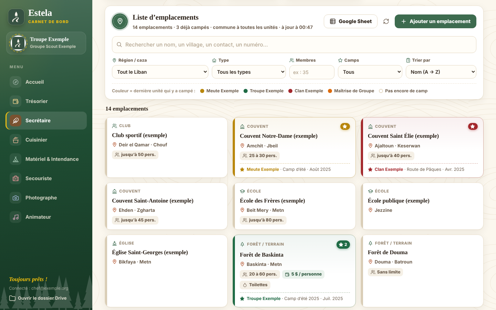

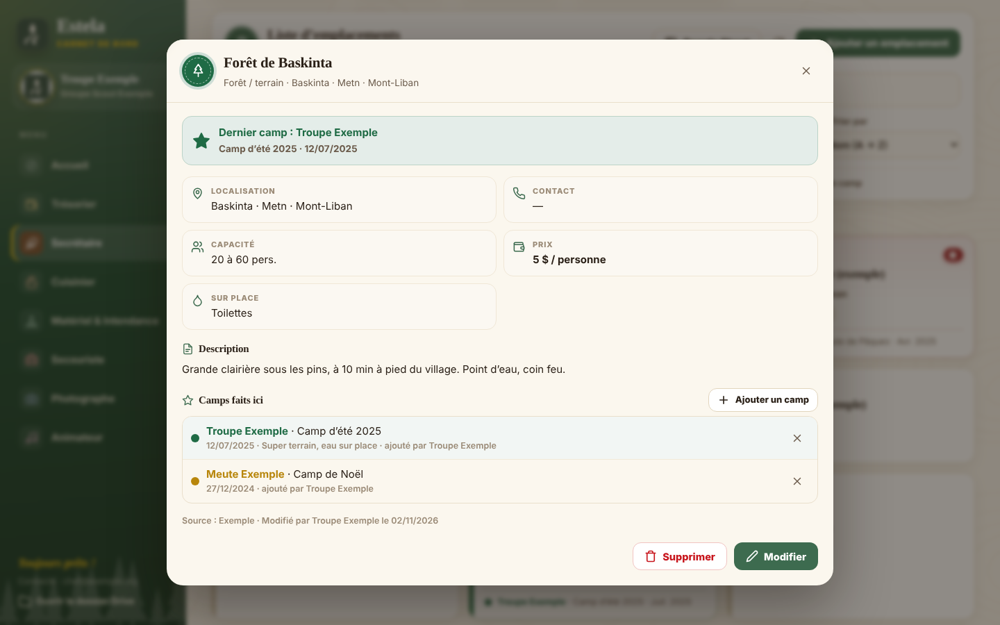

### Cuisinier: recipes

The unit's cookbook. Each recipe has its ingredients, steps and tips. The quantities **scale automatically** to the number of scouts.

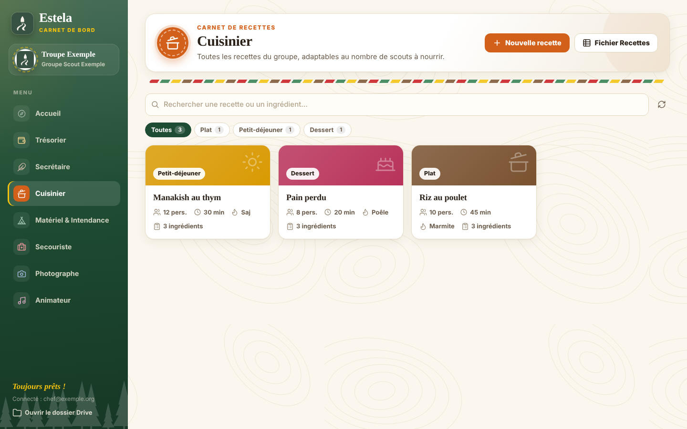

### Matériel & Intendance: equipment

The inventory of the unit's equipment, spread over several lists (general store, kitchen trunk, tents…). Each list is updated in one go, with totals per item across all lists and a history of every movement. The Troupe version also tracks the **firewood store**.

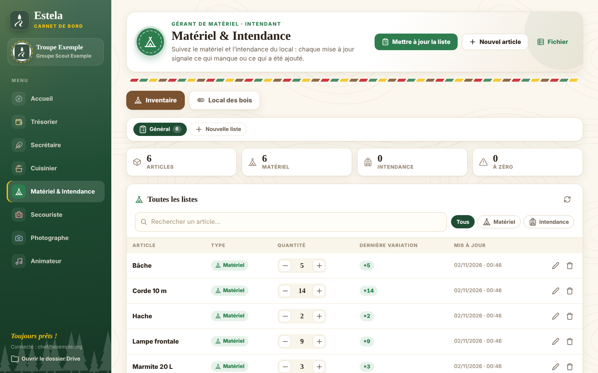

### Secouriste: first aid

The first-aid kit, with **expiry dates** and warnings for items that are running out or about to expire. The **Lebanese emergency numbers** are one tap away. A separate tab reads the members' **health forms** live from the unit's Google Form (allergies, treatments, emergency contact).

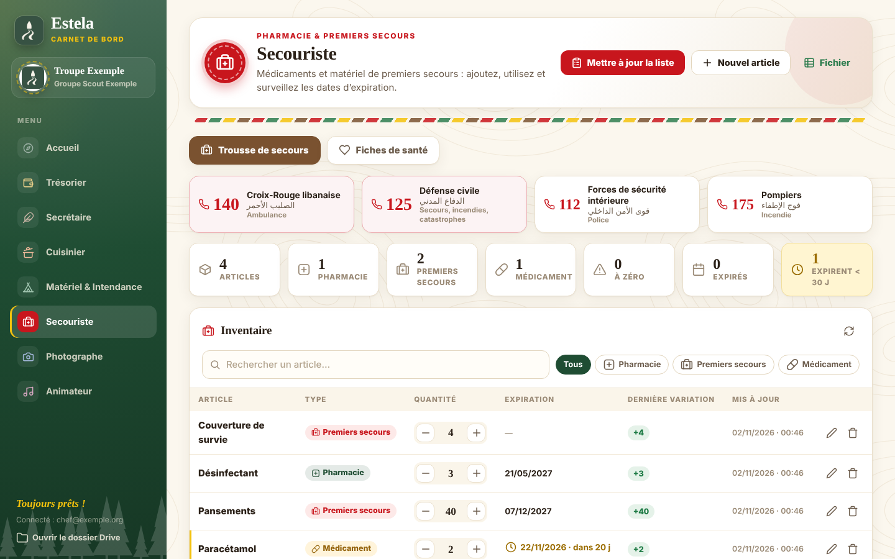

### Photographe: shot lists and Instagram covers

**Shot checklists.** For each activity, list the photos and videos to take. In the field, mark each one **Done** or **Not done**. Once everything is marked, the checklist moves to the history.

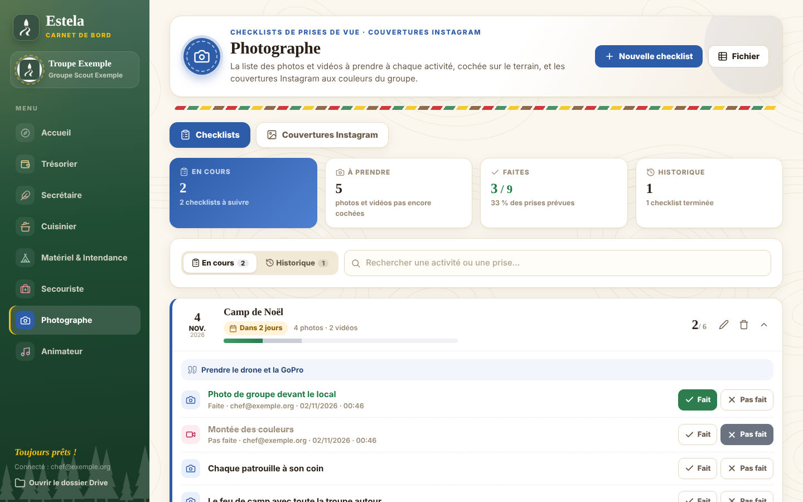

**Instagram cover maker.** Pick a photo, then frame it with a finger (drag, pinch, scroll to zoom). The group's template is drawn on top in three formats: post 4:3 (1440×1080), reel 9:16 (1080×1920) and portrait 3:4 (1080×1440). The template includes the logo, the activity title, the unit name, a white line and a coloured band. Everything happens **in the browser** on a canvas, and the photo is never uploaded.

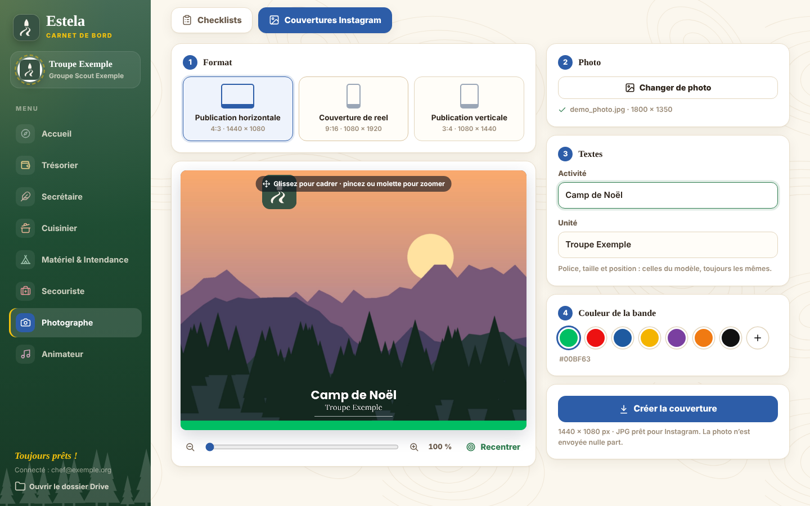

<p align="center">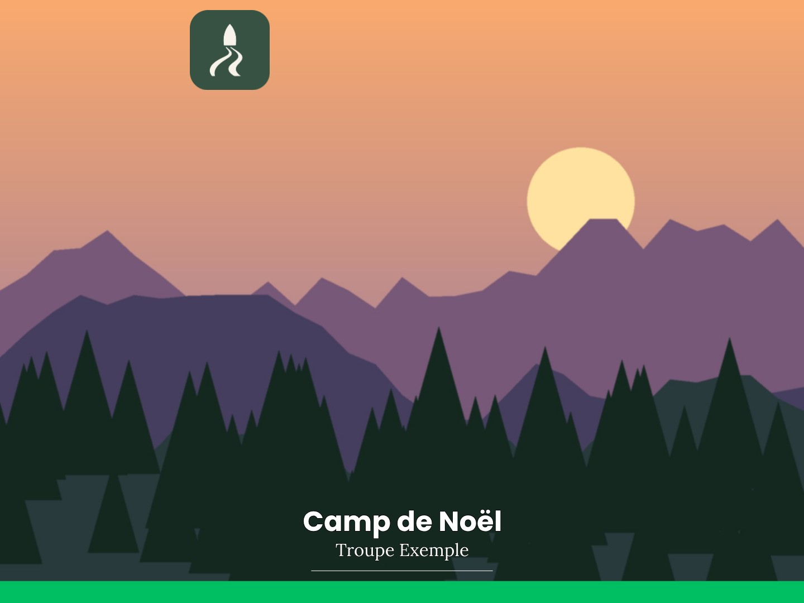<br><sub>The exported 1440 × 1080 cover.</sub></p>

### Animateur: repertoire and campfire evenings

**Repertoire:** sketches (with cast size and duration), songs, cheers and hymns, with lyrics and links.

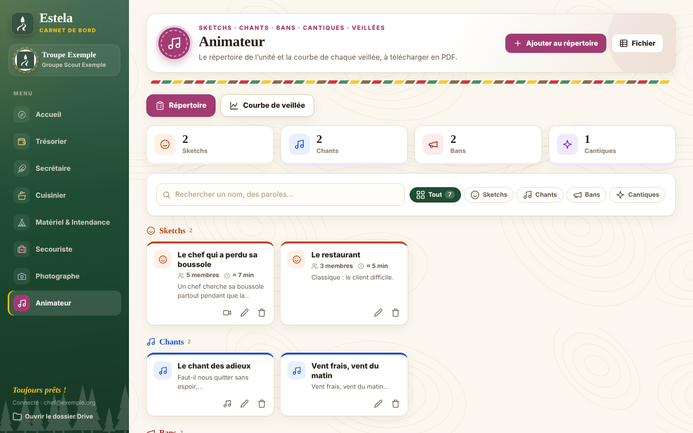

**Campfire evening planner** (*Courbe de veillée*): list the moments of the evening in order, give each an intensity, and Estela draws the **energy curve** with its timings. A good evening rises and then settles down calmly. The plan exports as a **PDF** with the curve and the lyrics, ready to print.

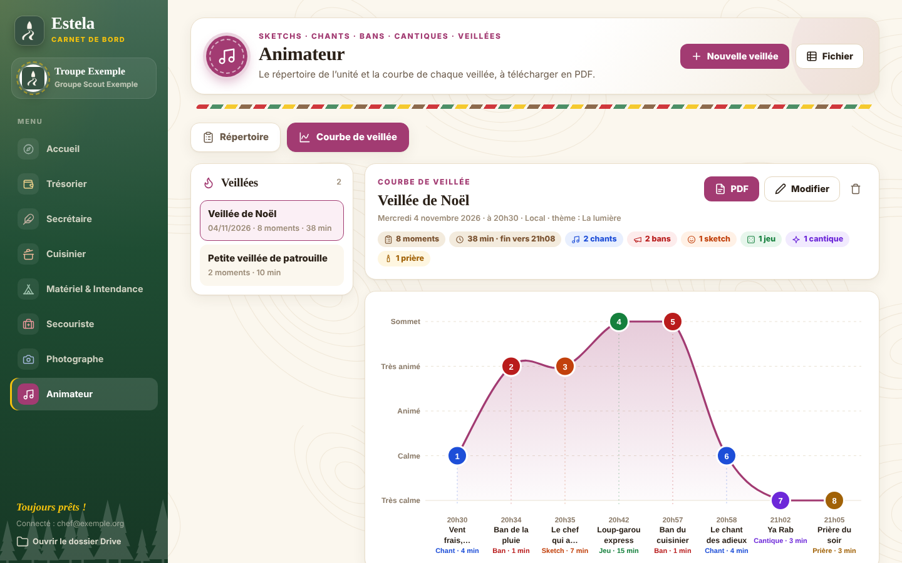

### Seasons and feast days

The home page decorates itself **automatically, every year**, from the date:

- **Christmas** all December, **New Year**, and **Easter**, with the Catholic and Orthodox dates computed every year.
- **Lebanese Independence Day**, and the units' **patron saints**: Saint Francis (Meute), Saint George (Troupe) and Saint Paul (Clan).
- Each has its own decorations, a greeting and light animations, which can be turned off. They respect *reduced motion*.

| Christmas | Saint George (Troupe) |
|---|---|
| 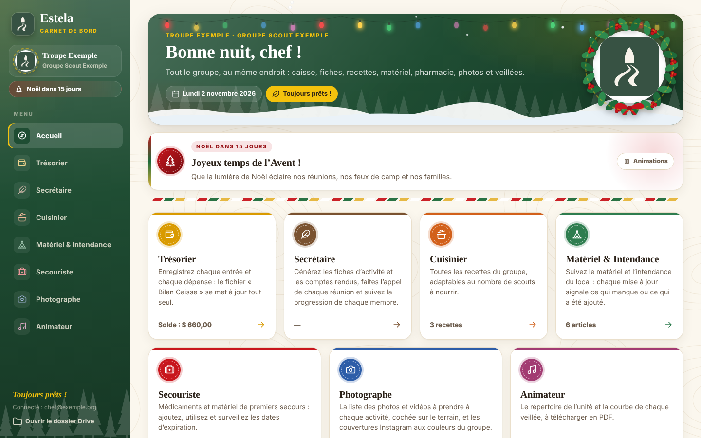 | 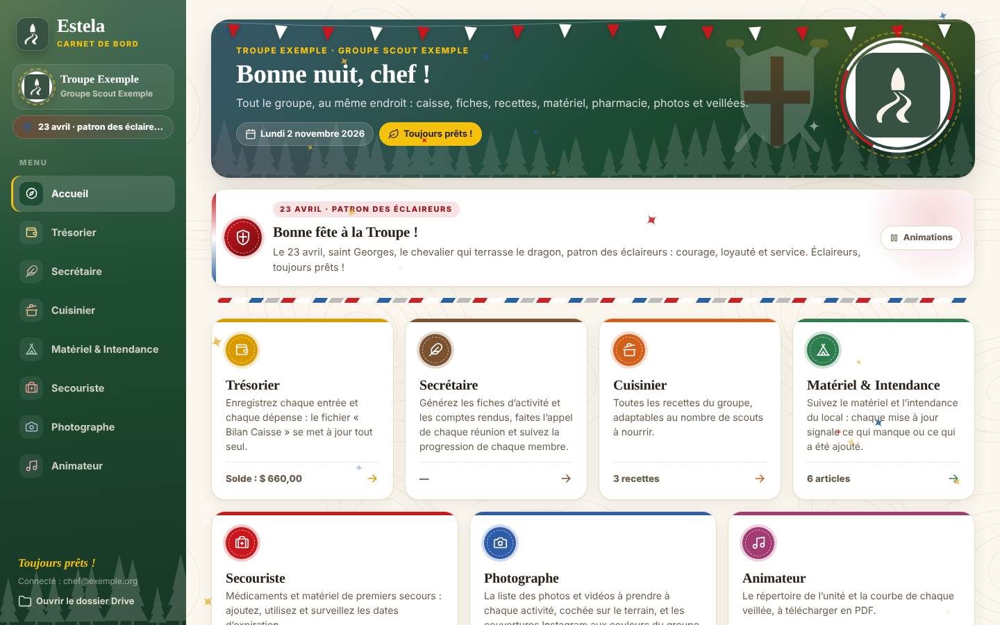 |

### On a phone

Every page and form fits a phone screen (tested at 360 and 390 px wide). The sidebar becomes a full-screen menu.

<p align="center">
  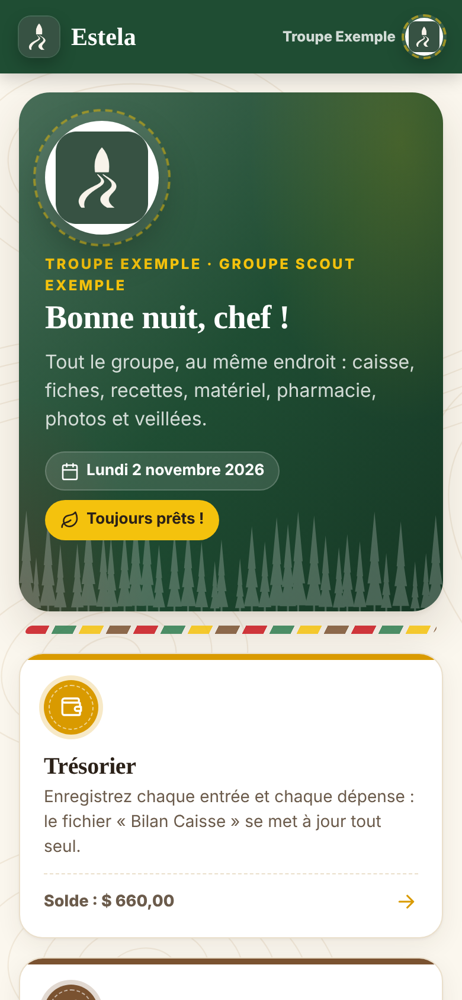
  &nbsp;
  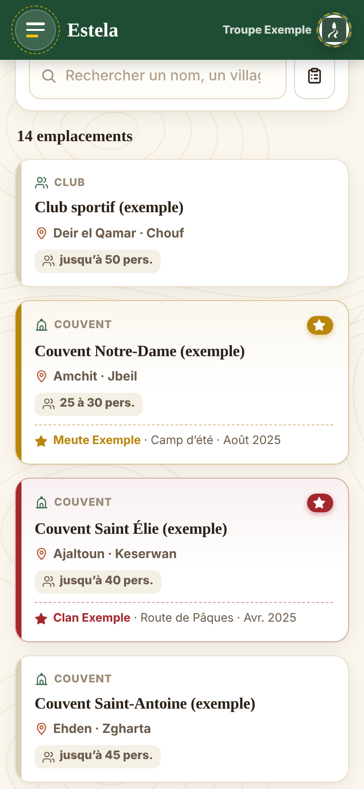
  &nbsp;
  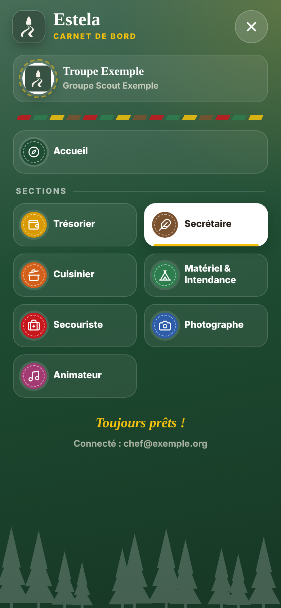
</p>

### Maîtrise de Groupe: the leadership app

The same code becomes the group leadership's app when `MAITRISE: true` is set. It has three spaces:

- **Its own work:** the Maîtrise's own treasury, sheets, attendance and so on, exactly like a unit.
- **Unit follow-up** (*Suivi des unités*): reads what each unit entered in its own app, section by section, in **read-only** mode. The one exception is photo checklists, which the Maîtrise can edit.
- **Administration:** an account and password per section, a "joker" key, which sections open without a password, and where each unit's folder is.

| Home | Unit follow-up |
|---|---|
| 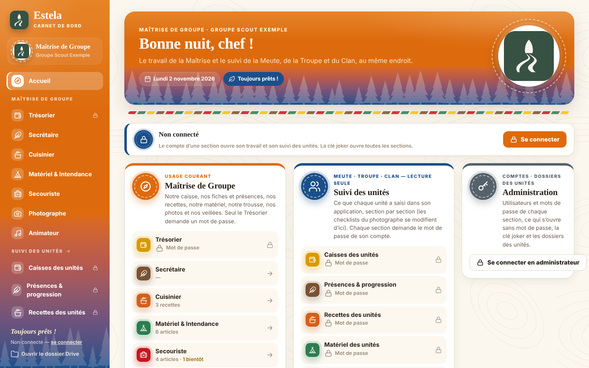 | 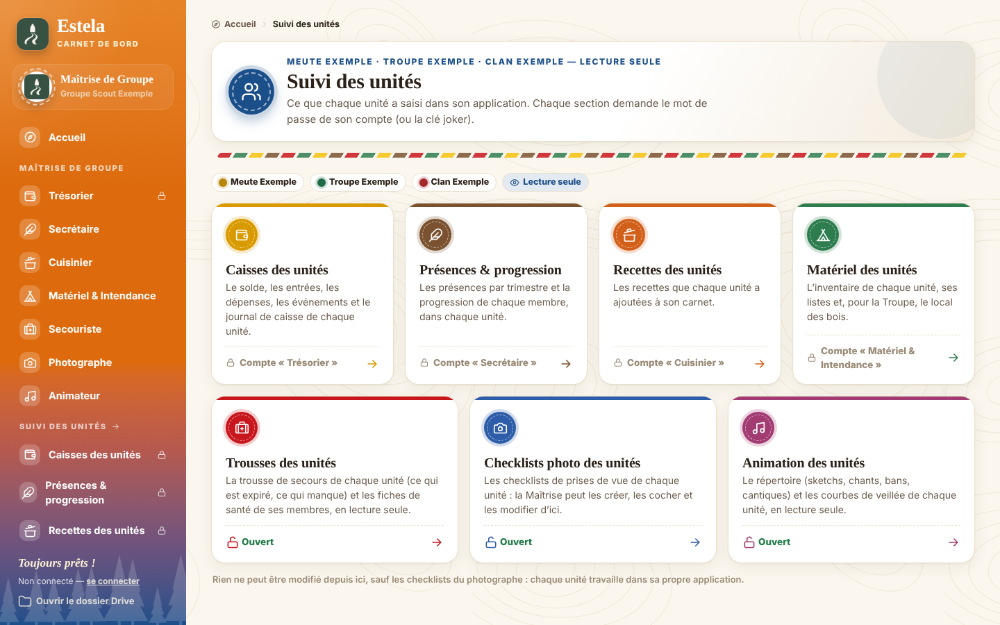 |

---

## How it works

```
 Phone / computer                 Google Apps Script                    Google Drive
┌──────────────────┐   google.script.run   ┌──────────────────┐   SpreadsheetApp  ┌───────────────────────┐
│ Index.html       │ ─────────────────────▶│ Code.gs          │ ─────────────────▶│ Info/                 │
│ one-page UI      │◀───────────────────── │ server functions │   DriveApp        │   Tresorerie/ …       │
│ (vanilla JS/CSS) │      JSON results     │ + access checks  │   DocumentApp     │   Secretariat/ …      │
└──────────────────┘                       └──────────────────┘                   │ Estela - Liste        │
                                                                                  │ d'emplacements shared │
                                                                                  └───────────────────────┘
```

**Back end (`Code.gs`)**
- Each unit is an Apps Script **web app** that lives in the unit's Drive folder. On first use it creates its own `Info/` folder tree and spreadsheets, and it finds them again **by name**. Renamed accents or capitals don't break anything, and old layouts are migrated automatically.
- **Sheets as a database:** a header row per tab, a hidden ID column, and generic helpers to read rows as objects, update by ID and append. New columns are added without touching existing ones.
- **Safety:** a script lock around every write. Text starting with `= + - @` is escaped so a cell can never become a formula. Every input is validated server-side.
- **Documents:** activity sheets and reports are filled from a Google Docs template with `{{TAGS}}`. The PDFs come from HTML (`Utilities.newBlob(html).getAs(PDF)`).
- **Leadership app:** salted SHA-256 password hashes, session tokens, a per-section access check at the start of every call, and a whitelist of callable functions. A *read-only context* lets the Maîtrise read a unit's files without ever writing to them.
- **Shared campsite list:** one spreadsheet read and written by apps deployed under different Google accounts. Rows are found by ID at write time, rows are added atomically with `appendRow`, and **optimistic versioning** refuses an edit if someone else changed the row in between.

**Front end (`Index.html`)**
- One page, **no framework and no build step**: vanilla JavaScript, CSS custom properties and inline SVG icons.
- A small state object, render functions that return HTML strings, and **event delegation** (`data-act`, `data-change`) instead of per-element listeners.
- **Canvas** for the Instagram covers (FontFace loading, text centred on its ink box, outlines, pointer and pinch gestures) and for the seasonal particle effects. **SVG** for the campfire curve.
- Optimistic updates (ticks show instantly and are saved in the background), toasts, modals, and skeleton loaders.
- Responsive from 360 px, `prefers-reduced-motion` respected, keyboard focus styles.

**Data cleaning (campsite list)**
- Tables were extracted from two PDF exports (one of them an Excel sheet split across 104 pages in column groups, with overlapping text in some cells).
- Types, villages and their spellings were normalised, and each village was mapped to its caza and region.
- Capacities were parsed from free text ("25 à 30 pax", "<90", "Unlimited"), and phone numbers were validated (old 7-digit formats, +961/00961 prefixes, "03-123456 / 71 234 567" lists).
- Duplicates were merged inside and across both lists, by name, village and shared phone number, so about 1,100 rows became about 970 places.

---

## Repository layout

```
README.md                       ← this page
estela/
├── apps-script/
│   ├── unite/                  ← the app of one unit (example: "Troupe Exemple")
│   │   ├── Code.gs             server code; settings at the top (⚙️ RÉGLAGES)
│   │   ├── Index.html          the whole interface (HTML + CSS + JS)
│   │   ├── Logo.html           group logo, as a data URI
│   │   ├── Icone.html          app icon, as a data URI
│   │   ├── Couverture.html     Instagram cover templates + fonts (JSON)
│   │   ├── Emplacements.html   starting campsite list (JSON; here: invented examples)
│   │   └── appsscript.json     manifest (Beirut time zone, web app)
│   └── maitrise/               ← the group leadership's app (same files, MAITRISE: true)
└── docs/
    └── screenshots/
```

---

## Install your own copy

**Setup takes about 10 minutes.**

1. **Create a folder** in Google Drive for the unit (e.g. `Troupe Exemple`). Inside it, choose **New › More › Google Apps Script** and name the project `Programme SSCC`.
2. **Paste the code.**
   - Replace the contents of `Code.gs` with `estela/apps-script/unite/Code.gs`.
   - Add the HTML files with **＋ › HTML**. Name them exactly `Index`, `Logo`, `Icone`, `Couverture` and `Emplacements`, and paste the matching files into them.
3. **Time zone:** in *Project settings*, set `Asia/Beirut` (or your own).
4. **First run:** choose the `installer` function and click **Run**. Accept the permissions. This creates the `Info/` folder and all the spreadsheets.
5. **Deploy:** **Deploy › New deployment › Web app**.
   - Unit app: *Execute as* **User accessing the web app**. *Who has access:* your leaders.
   - Maîtrise app: *Execute as* **Me**.
6. **Share** the unit folder as **Editor** with the leaders who will use the app, then send them the web-app link. The app can also be installed as a shortcut on a phone's home screen.

For the **leadership app**, repeat the steps with `estela/apps-script/maitrise/` in a separate folder. Its starting accounts and joker key are placeholders (`changez-moi`). Change them in **Administration › Comptes** on the first login.

---

## Customise it

Everything specific to a group is at the top of `Code.gs`, in the **⚙️ RÉGLAGES** block:

| Setting | Example |
|---|---|
| Name and group | `NOM: 'Troupe Exemple'`, `GROUPE: 'Groupe Scout Exemple'` |
| Colours | `COULEUR_PRINCIPALE: '#1F4D33'`, `COULEUR_ACCENT: '#F4C20D'` |
| Sub-groups and roles | `UNITES: ['Lions', 'Loups', …]`, `ROLES: ['CP', 'SP']` |
| Progression system | `PROGRESSION: 'troupe'` / `'meute'` / `'clan'` / `false` |
| Optional features | `LOCAL_DES_BOIS`, `SERVICES`, `ORDRE_DU_JOUR`, `COMPTE_RENDU` |
| Leadership app | `MAITRISE: true` + the `MAITRISE` block (units, folders, accounts) |

The cover templates (logo position, font sizes, band) live in `Couverture.html`. The activity-sheet and report templates are ordinary Google Docs in `Info/Secretariat/Modeles`, and they can be restyled freely as long as the `{{TAGS}}` stay.

---

## Privacy and security

- All data stays in the group's own Google Drive. There is no third-party server and no tracking.
- Health records are only read from the unit's Google Form, live, and are never copied elsewhere.
- In the leadership app, passwords are stored hashed, sessions expire after 12 hours, and repeated wrong attempts lock an account for 10 minutes.
- This public copy contains **no real names, contacts or passwords**.

---

## Credits

- Fonts used for the covers: [Poppins](https://fonts.google.com/specimen/Poppins) and [Lora](https://fonts.google.com/specimen/Lora), both under the SIL Open Font License. The interface uses [Bitter](https://fonts.google.com/specimen/Bitter) and [Nunito Sans](https://fonts.google.com/specimen/Nunito+Sans) from Google Fonts.
- Designed and built for a scout group in Lebanon.
